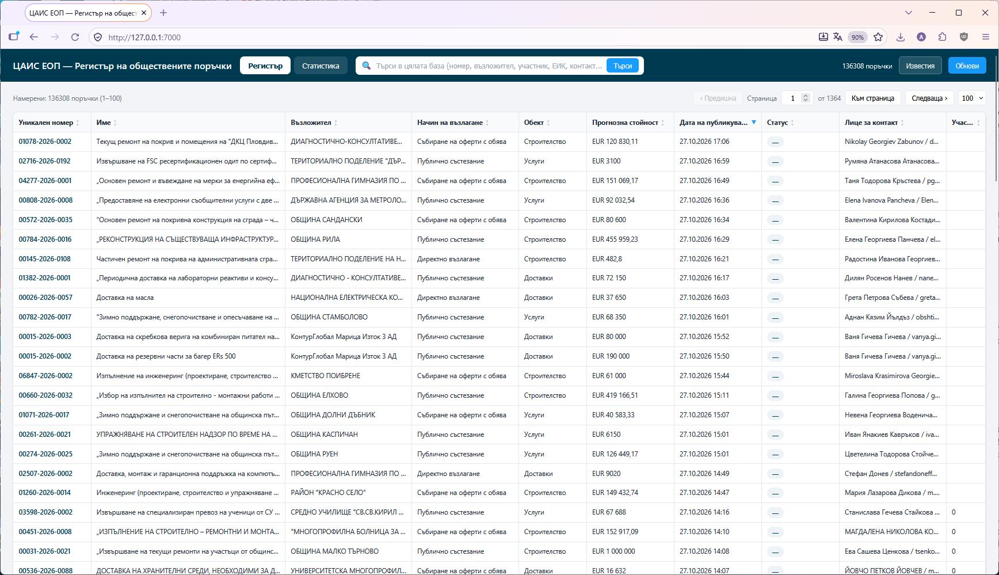
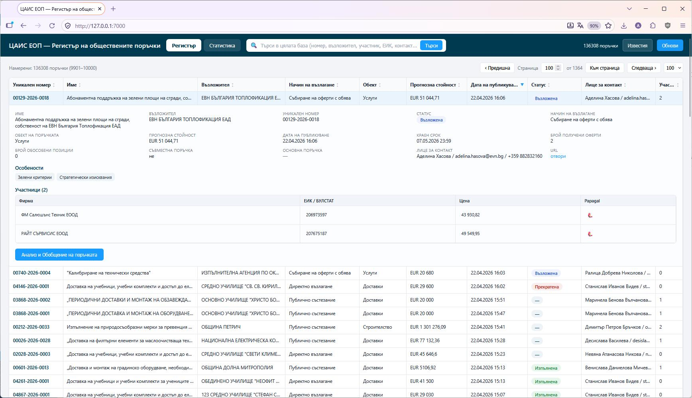
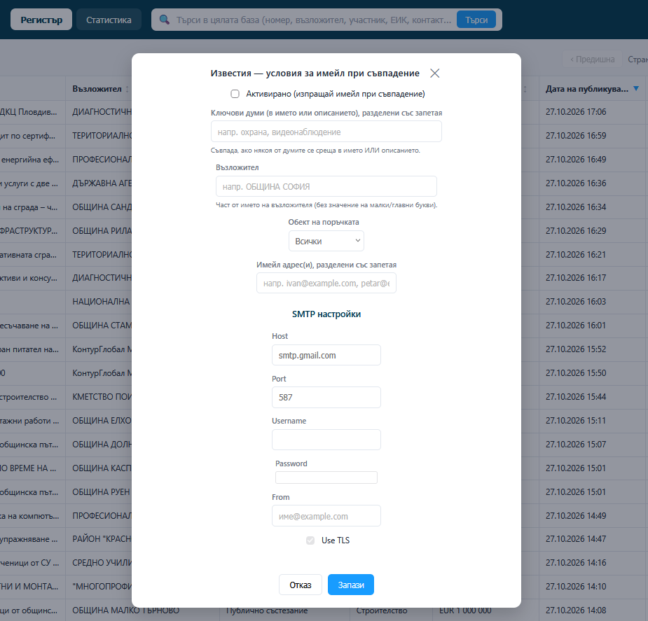
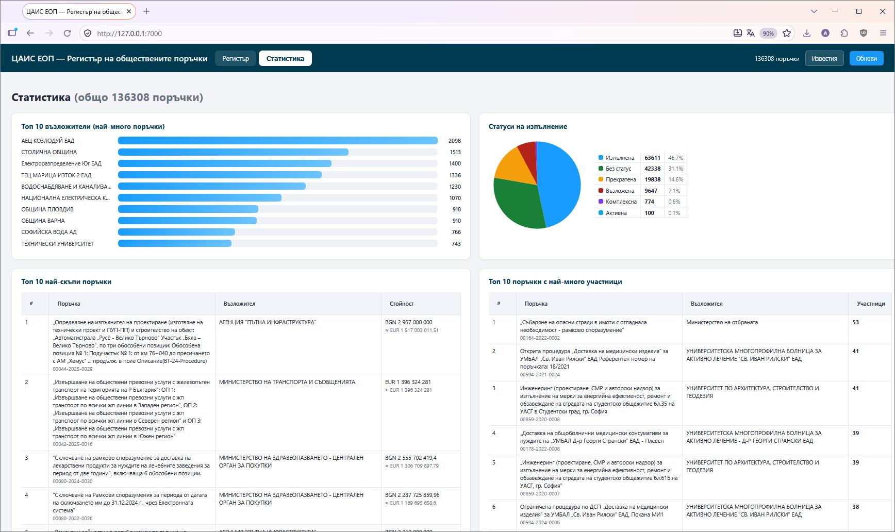
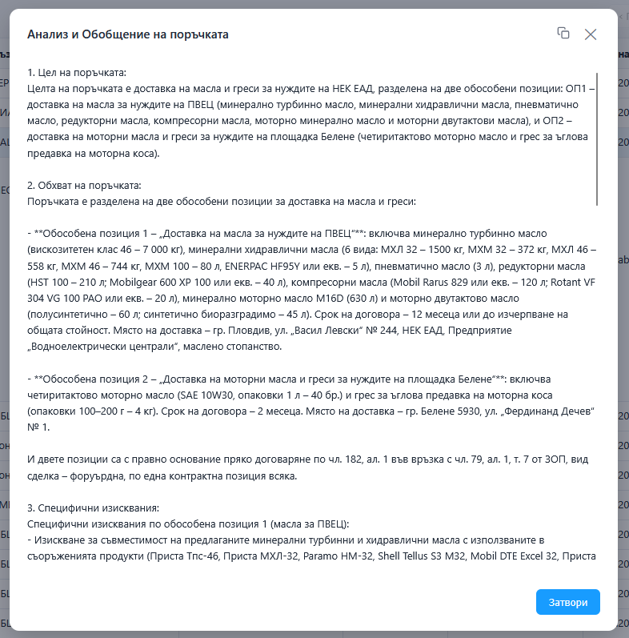

# Инструменти за преглед на обществени поръчки от портала на ЦАИС ЕОП

Набор от Python скриптове за събиране, наблюдение и преглед на обществени
поръчки от българската платформа **ЦАИС ЕОП** (`https://app.eop.bg/today`).

Пакетът позволява:

- **Пълно събиране** на всички публикувани поръчки (исторически архив) в SQLite;
- **Наблюдение** на новопубликуваните поръчки (на всеки N секунди) и изпращане
  на **имейл известия** при съвпадение по зададени условия;
- **Уеб интерфейс** за преглед, търсене, сортиране и статистики;
- **AI анализ и обобщение** на всяка поръчка чрез DeepSeek.







---

## Файлове в пакета

| Файл | Описание |
|---|---|
| `collect_history.py` | Събира всички публикувани поръчки (регистъра) в база данни. |
| `eop_monitor.py` | Наблюдава за нови поръчки и изпраща имейл при съвпадение. |
| `web_ui.py` | Уеб интерфейс (преглед, статистики, AI анализ, известия). |
| `web_ui.cfg` | Конфигурационен файл с настройките. |

---

## Изисквания

### Python

- **Python 3.10+** (тествано с 3.10.12)

### Python библиотеки

| Библиотека | Версия (тествана) | За какво се използва |
|---|---|---|
| `httpx` | 0.28.1 | HTTP заявки към API на ЦАИС ЕОП и DeepSeek |
| `playwright` | 1.52.0 | headless Chromium (за `eop_monitor.py`) |
| `pypdf` | 6.21.2 | извличане на текст от PDF (за AI анализа в `web_ui.py`) |
| `python-docx` | 1.2.0 | извличане на текст от DOCX (за AI анализа в `web_ui.py`) |

Останалите зависимости са от стандартната библиотека на Python
(`sqlite3`, `http.server`, `configparser`, `smtplib`, `email`, `argparse`, …).

### Системни инструменти (по избор, за по-добро извличане на текст)

За AI анализа на прикачените файлове (`web_ui.py`) се използват следните
външни програми, когато са налични (иначе файловете се пропускат частично):

- `pdftotext` (от **poppler-utils**) — за PDF;
- `soffice` / `libreoffice` — за `.doc`, `.xls` и други офис формати.

---

## Инсталация

```bash
# 1) Клонирайте хранилището и влезте в папката
git clone <URL> && cd <папка>

# 2) (препоръчително) създайте виртуална среда
python3 -m venv .venv
source .venv/bin/activate

# 3) Инсталирайте зависимостите
pip install httpx playwright pypdf python-docx

# 4) Инсталирайте браузъра за Playwright
playwright install chromium

# 5) (по избор) системни инструменти за извличане на текст
#    Debian/Ubuntu:
sudo apt install poppler-utils libreoffice
```

---

## Конфигурация — `web_ui.cfg`

Конфигурационният файл се намира до скриптовете и съдържа три секции:

```ini
[deepseek]
; API ключ за DeepSeek (https://platform.deepseek.com/api_keys)
api_key = sk-xxxxxxxx
base_url = https://api.deepseek.com
model = deepseek-chat
timeout = 300

[notifications]
; Активиране на известяването по имейл при съвпадение.
enabled = false
; Ключови думи (разделени със запетая) — търсят се в името ИЛИ описанието.
keywords =
; Възложител (част от името, без значение на малки/главни букви).
organization =
; Обект на поръчката: Услуги / Доставки / Строителство (празно = всички).
object =
; Имейл адрес(и), разделени със запетая.
emails =

[smtp]
; Настройки за изпращане на имейл (SMTP).
host = smtp.gmail.com
port = 587
username =
password =
from =
use_tls = true
```

> **Забележка:** настройките за известията и SMTP могат да се редактират и от
> уеб интерфейса — бутон **„Известия“** в горния десен ъгъл.

---

## Употреба

### 1. `collect_history.py` — пълно събиране на регистъра

Събира **всички** публикувани поръчки (независимо от статуса) в SQLite база данни.
Работи на две фази и е **възобновяем** (може да се спира и пуска по всяко време).

**Опции:**

| Опция | По подразбиране | Описание |
|---|---|---|
| `--db PATH` | `eop_history.db` | път до SQLite базата |
| `--workers N` | `8` | брой паралелни заявки при обогатяване |
| `--limit N` | без | обогати само първите N поръчки (за тест) |
| `--list-limit N` | без | събери само първите N поръчки от списъка (за тест) |
| `--skip-enrich` | изкл. | само фаза 1 (списък), без статус/участници |

**Примери:**

```bash
# Пълно събиране (списък + обогатяване със статус и участници)
python3 collect_history.py --db eop.db

# Бърз тест — само 60 поръчки от списъка, обогати 5
python3 collect_history.py --db eop.db --list-limit 60 --limit 5

# Само списъка (без обогатяване)
python3 collect_history.py --db eop.db --skip-enrich
```

### 2. `eop_monitor.py` — наблюдение на нови поръчки

Проверява на всеки N секунди страницата „Публикувани днес“ и отпечатва/записва
новите поръчки. При активирани известия в `web_ui.cfg` изпраща имейл при
съвпадение на условията.

**Опции:**

| Аргумент | По подразбиране | Описание |
|---|---|---|
| `interval` | `60` | интервал на проверка в секунди (позиционен) |
| `--db PATH`, `-d PATH` | `eop.db` | път до SQLite базата |

**Примери:**

```bash
# Проверка на всеки 60 секунди, база по подразбиране (eop.db)
python3 eop_monitor.py

# Проверка на всеки 30 секунди в конкретна база
python3 eop_monitor.py 30 --db eop.db

# Същото с къс запис
python3 eop_monitor.py -d eop.db 30
```

> Първото стартиране прави „базова моментна снимка“ на текущите поръчки и не ги
> отпечатва. След това се отпечатват само новопоявилите се поръчки.

### 3. `web_ui.py` — уеб интерфейс

Стартира локален уеб сървър с интерфейс за преглед на базата.

**Опции:**

| Опция | По подразбиране | Описание |
|---|---|---|
| `--port N` | `7000` | порт на сървъра |
| `--db PATH` | `eop_history.db` | път до SQLite базата |

**Пример:**

```bash
python3 web_ui.py --db eop.db
# след това отворете: http://127.0.0.1:7000/
```

**Раздели в интерфейса:**

- **Регистър** — таблица с всички поръчки: търсене в цялата база, сортиране,
  странициране, разгъване на ред, преоразмеряване на колоните.
- **Статистика** — топ възложители, статуси (pie chart), най-скъпи поръчки,
  поръчки по месеци/години, топ 20 градове, стойности по години и общо.
- **Анализ и Обобщение на поръчката** (бутон в детайлите на всяка поръчка) —
  AI анализ чрез DeepSeek (всяка точка в отделна заявка) с възможност за
  копиране на резултата.
- **Известия** (бутон горе вдясно) — настройка на условията за имейл известия
  и SMTP.

---

## Препоръчителен работен процес

```bash
# 1) Съберете пълната история (веднъж, или периодично обновявайте)
python3 collect_history.py --db eop.db

# 2) Пуснете наблюдението за нови поръчки (в отделен терминал)
python3 eop_monitor.py --db eop.db

# 3) Пуснете уеб интерфейса (в отделен терминал)
python3 web_ui.py --db eop.db
```

Всичките три скрипта могат да работят с **една и съща** база (`eop.db`),
защото използват една и съща схема (`tenders`).

---

## Бележки

- `collect_history.py` и `web_ui.py` използват по подразбиране `eop_history.db`,
  а `eop_monitor.py` — `eop.db`. Препоръчва се изрично да се подава `--db eop.db`
  за единна база.
- AI анализът изисква валиден `api_key` за DeepSeek в `web_ui.cfg`.
- Изпращането на имейл изисква попълнени `[smtp]` настройки и отметнато
  „Активирано“ в известията.
- Данните идват от публичната JSON услуга на ЦАИС ЕОП
  (`https://service.eop.bg/NX1Service.svc/...`).
